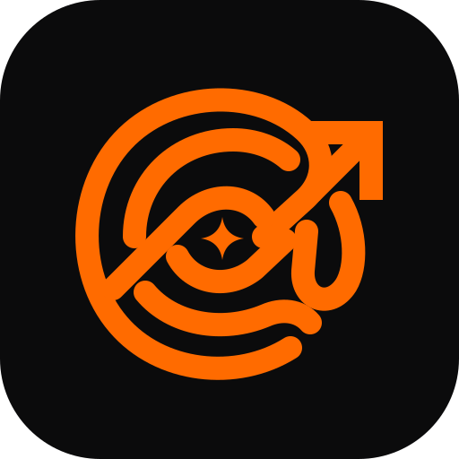

<div align="center">
  

  <h1>ThreadsHunter — Threads Affiliate AI Engine</h1>

  <p>
    <strong>Autonomous Threads Buying-Intent Discovery, Universal Multi-LLM Scoring &amp; Shopee Affiliate Smart Reply Studio</strong>
  </p>

  <p>
    
    
    
    
    
  </p>
</div>

---

## Overview

**ThreadsHunter** adalah platform full-stack untuk memantau postingan Threads (`threads.com` / `threads.net`) yang sedang mencari rekomendasi produk, menilai niat beli secara otomatis menggunakan **AI Router universal** (Gemini, 9Router, OpenRouter, Groq, DeepSeek, atau Ollama lokal), lalu meracik balasan bahasa Indonesia kasual yang natural lengkap dengan link **Shopee Affiliate**.

Seluruh antarmuka dibangun menggunakan **Obsidian (`#0B0B0C`) & Electric Orange (`#FF6B00`) Dark Editorial Bento Design System** — dengan dukungan mode **SEMI_AUTO** (review & 1-klik kirim di Web UI) maupun **FULL_AUTO** (balas otomatis dengan cooldown acak dan proteksi anti-ban).

---

## Fitur Utama

- **Universal Multi-LLM AI Router**
  - Tidak terkunci pada satu provider. Menggunakan `AsyncOpenAI(api_key=..., base_url=...)` + dukungan native `google-genai`.
  - Quick Preset langsung di halaman Settings: **Google Gemini**, **9Router / Custom OpenAI**, **OpenRouter**, **Groq**, dan **DeepSeek**.
  - **Live AI Sandbox (`POST /api/settings/test-ai`)** untuk mengetes koneksi, melihat latency (`ms`), skor intent, produk yang cocok, serta preview draft balasan sebelum menjalankan bot.
- **Dynamic Live Configuration di PostgreSQL**
  - Semua pengaturan (Base URL, API Key, Model, System Prompt Persona, Search Keywords, Bot Mode, Max Comments/Day, Interval Scan) tersimpan di PostgreSQL dan berlaku **real-time tanpa restart Docker container**.
- **Playwright Stealth & Anti-Ban Emulation**
  - Stealth browser flags (`--disable-blink-features=AutomationControlled`, `locale=id-ID`, `timezone=Asia/Jakarta`, masking `navigator.webdriver`).
  - Jeda acak natural, scroll bertahap, pengetikan karakter demi karakter (`45–110ms`), cooldown `45–120` detik untuk `FULL_AUTO`, dan batas kuota komentar harian.
- **Fleksibel Ambil Sesi Threads (3 Cara)**
  - Login dengan **Google Chrome asli** (profil khusus bot permanen), **profil Chrome Windows kamu sendiri**, atau langsung upload **Export JSON dari ekstensi Chrome Cookie-Editor** di halaman Settings.
- **Editorial Bento Dashboard (4 Halaman)**
  - `/` **Overview Command Center** — Asymmetric Hero, Stacked Orange KPI Counters, `01–03` Live Pipeline Cards + switch `SEMI_AUTO`/`FULL_AUTO`, dan Live Activity Feed.
  - `/leads` **Smart Reply Studio** — Bento grid 3 kolom dengan sorotan **Featured Electric Orange Card** untuk lead `intent_score >= 90`, editor balasan, 1-klik Auto-Reply, Copy, dan Skip.
  - `/products` **Shopee Affiliate Catalog** — Manajemen produk, kategori, range harga, selling points, shortlink Shopee, dan toggle Active/Paused.
  - `/settings` **AI Router, Anti-Ban & Auth Uploader** — Preset AI, interactive keyword chips, slider anti-ban, Telegram alerts opsional, dan dropzone upload sesi.

---

## Struktur Monorepo

```text
├── docker-compose.yml               # PostgreSQL 16 + FastAPI/Playwright Backend + Next.js 15 Frontend
├── .env.example                     # Template environment variables
├── .gitignore                       # Melindungi .env, auth_threads.json, dan chrome_profile/
├── backend/
│   ├── Dockerfile                   # Python 3.11-slim + Playwright Chromium (--with-deps)
│   ├── requirements.txt
│   ├── login_helper.py              # Helper login Chrome lokal & importer Cookie-Editor JSON
│   ├── data/
│   │   ├── auth_threads.example.json
│   │   └── seed_products.json       # Katalog awal Shopee Affiliate (auto-seed saat DB kosong)
│   └── app/
│       ├── main.py                  # FastAPI entry point, CORS, lifespan DB init & scheduler
│       ├── config.py                # Konfigurasi environment (DATABASE_URL, CORS_ORIGINS)
│       ├── database.py              # Async SQLAlchemy 2.0 + asyncpg engine & seeder
│       ├── models.py                # ORM: products, lead_posts, bot_settings, daily_stats
│       ├── schemas.py               # Pydantic v2 request/response schemas
│       ├── routers/
│       │   ├── products.py          # CRUD /api/products
│       │   ├── leads.py             # Queue, edit draft, instant reply /api/leads
│       │   ├── settings.py          # Live config & /api/settings/test-ai
│       │   └── bot_control.py       # Scheduler, manual scan, KPI stats, upload-auth
│       └── services/
│           ├── ai_service.py        # Universal OpenAI-compatible & native google-genai client
│           ├── scraper.py           # Playwright stealth search, reply & cookie normalizer
│           ├── scheduler.py         # APScheduler periodic background worker
│           └── telegram.py          # Notifikasi Telegram opsional
└── frontend/
    ├── Dockerfile                   # Multi-stage Next.js 15 standalone build
    ├── package.json
    ├── tailwind.config.ts           # Token warna Obsidian & Electric Orange
    ├── public/
    │   └── logo.svg                 # Brand logo (taruh logo.jpg di sini untuk override JPEG)
    └── src/
        ├── app/                     # /, /leads, /products, /settings
        ├── components/              # BrandLogo, Navbar, PillButton, StatCounter, LeadCard, ui/*
        └── lib/                     # api.ts & utils.ts
```

---

## Quick Start (Docker Compose — Lokal / Linux VPS)

1. **Salin file environment**:
   ```bash
   cp .env.example .env
   ```
   *(Di VPS Linux, ubah `NEXT_PUBLIC_API_URL` di `.env` menjadi `http://<IP_VPS_KAMU>:8000` dan tambahkan origin frontend di `CORS_ORIGINS`.)*

2. **Jalankan seluruh stack dengan satu perintah**:
   ```bash
   docker compose up -d --build
   ```

3. **Buka aplikasi**:
   - **Web Dashboard**: `http://localhost:3000`
   - **API Docs (Swagger UI)**: `http://localhost:8000/docs`
   - **Health Check**: `http://localhost:8000/api/health`

---

## Cara Menghubungkan Sesi Threads (`auth_threads.json`)

Pilih salah satu dari 3 cara berikut:

### Opsi 1 — Export Cookie dari Chrome yang Sudah Login (Tercepat)
1. Buka `https://www.threads.com` di Google Chrome harianmu (pastikan sudah login).
2. Pasang ekstensi **Cookie-Editor** -> klik **Export -> Export as JSON** (`cookies.json`).
3. Drag-and-drop file `cookies.json` langsung di menu **Settings -> Threads Session** pada Web Dashboard (backend otomatis mengonversi ke format Playwright), atau jalankan:
   ```bash
   cd backend
   python login_helper.py --import-cookies path/to/cookies.json
   ```

### Opsi 2 — Login via Google Chrome Profil Khusus Bot
```bash
cd backend
pip install playwright
playwright install chromium
python login_helper.py
```
Login akun Threads di jendela Google Chrome yang terbuka, lalu ketik `ok` + Enter di terminal.

### Opsi 3 — Pakai Profil Chrome Windows Kamu Langsung
Tutup semua jendela Google Chrome terlebih dahulu, lalu jalankan:
```bash
cd backend
python login_helper.py --use-my-chrome
```

---

## Daftar Preset AI Provider

Konfigurasi langsung dari halaman **`/settings`**:

| Preset | Mode SDK | Base URL | Contoh Model |
| :--- | :--- | :--- | :--- |
| **Google Gemini** | `openai_compatible` / `google_genai` | `https://generativelanguage.googleapis.com/v1beta/openai/` | `gemini-2.5-flash` |
| **9Router / Custom** | `openai_compatible` | `http://localhost:20128/v1` | `gemini-2.5-flash` |
| **OpenRouter** | `openai_compatible` | `https://openrouter.ai/api/v1` | `google/gemini-2.5-flash` |
| **Groq** | `openai_compatible` | `https://api.groq.com/openai/v1` | `llama-3.3-70b-versatile` |
| **DeepSeek** | `openai_compatible` | `https://api.deepseek.com/v1` | `deepseek-chat` |

---

## Ringkasan REST API

| Method | Endpoint | Fungsi |
| :--- | :--- | :--- |
| `GET` | `/api/health` | Status kesehatan backend |
| `GET / POST` | `/api/products` | List & tambah produk Shopee Affiliate |
| `PATCH / DELETE` | `/api/products/{id}` | Edit, toggle active, atau hapus produk |
| `GET` | `/api/leads` | List & filter leads (`PENDING_REVIEW`, `COMMENTED`, `IGNORED`, `FAILED`) |
| `PATCH` | `/api/leads/{id}` | Edit draft balasan atau ubah status lead |
| `POST` | `/api/leads/{id}/reply` | Kirim balasan langsung ke Threads via Playwright stealth |
| `GET / PATCH` | `/api/settings` | Baca & update konfigurasi AI, keyword, anti-ban secara live |
| `POST` | `/api/settings/test-ai` | Uji koneksi LLM + preview evaluasi JSON & latency |
| `GET` | `/api/bot/status` & `/api/bot/stats` | Status scheduler, auth cookie, live logs, dan KPI harian |
| `POST` | `/api/bot/scan` | Picu manual scan Threads di background |
| `POST` | `/api/bot/scheduler/start` & `/stop` | Mulai / hentikan APScheduler periodik |
| `POST` | `/api/bot/upload-auth` | Upload `auth_threads.json` atau JSON Cookie-Editor |

---

## Development Lokal (Tanpa Docker)

```bash
# 1. Backend (pastikan PostgreSQL 16 berjalan & DATABASE_URL sesuai di .env)
cd backend
python -m venv .venv
.\.venv\Scripts\Activate.ps1
pip install -r requirements.txt
playwright install chromium
uvicorn app.main:app --reload --port 8000

# 2. Frontend (terminal terpisah)
cd frontend
npm install
npm run dev
```

---

## Catatan Keamanan

- **Jangan pernah commit** file `.env`, `backend/data/auth_threads.json`, folder `backend/data/chrome_profile/`, atau file `cookies.json` ke repository publik (semuanya sudah masuk `.gitignore`).
- Gunakan batas komentar harian yang aman (`<= 12` komentar/hari pada mode `FULL_AUTO`) untuk menjaga reputasi akun Threads.
